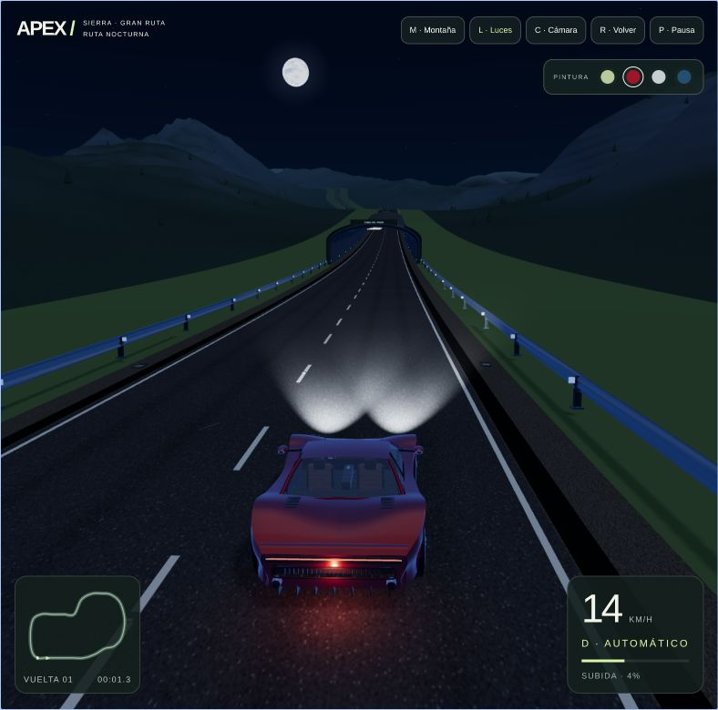
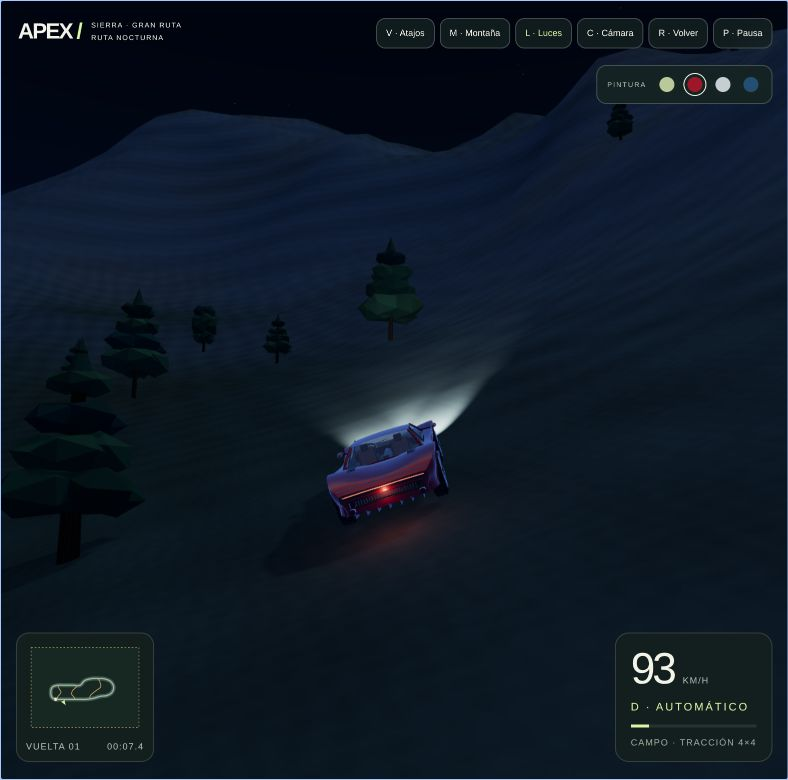

# APEX — Night Drive

## [▶ Jugar ahora](https://apex-night-drive.pages.dev/)

Juega gratis desde el navegador, sin descargar ni instalar nada.

Un juego de conducción 3D para navegador, con carreteras de montaña, exploración libre y persecuciones policiales bajo la luna. Conduce por el asfalto, busca atajos entre los árboles o sal de la pista para intentar escapar.

## El juego

- **Persecución dinámica:** la patrulla busca interceptar tu posición actual y anticipa tu movimiento. Puede elegir rutas en ambos sentidos y usar los atajos.
- **Choques con margen para escapar:** un golpe no termina la partida. La policía necesita mantener **5 segundos de contacto** para atraparte; separarte reinicia la captura. Una cuenta atrás muestra el peligro.
- **Dificultad progresiva:** la intensidad aumenta cada 30 segundos. Tu velocidad máxima pasa de **100 a 120 km/h** y el máximo de la patrulla aumenta de **106 a 135 km/h**.
- **Física compartida:** ambos coches tienen suspensión por rueda, motor, frenos, agarre y colisiones reales. Pueden perder velocidad, derrapar, saltar y volcar. Puedes enderezar tu coche en el mismo sitio; la patrulla también se recupera tras quedar volcada.
- **Montaña explorable:** un circuito de unos **5,2 km**, subidas y bajadas de hasta el 27 %, tres atajos de tierra y un entorno de **3,8 × 2,9 km** con 800 árboles.
- **Ambiente nocturno:** luna visible, cordilleras, faros con encendido manual, luces policiales animadas y carretera a cielo abierto.
- **Tu manera de conducir:** pintura configurable, cuatro cámaras exteriores, retrovisor, minimapa, indicador de la patrulla y controles táctiles.

## Capturas

| Carretera bajo la luna | Exploración por las montañas |
| --- | --- |
|  |  |

*Capturas del desarrollo; muestran una versión anterior del escenario y la interfaz.*

## Con qué se hizo

| Tecnología | Su papel en el juego |
| --- | --- |
| **Three.js** | Escena 3D y renderizado WebGL: coches, terreno, iluminación, materiales y cámaras. |
| **Rapier 3D + WebAssembly** | Cuerpos físicos, colisiones, suspensión y ruedas de ambos coches. La simulación funciona a 120 Hz. |
| **TypeScript y JavaScript** | Lógica del juego, conducción, IA policial, navegación, generación del mundo y gestión de la escena. |
| **Vite** | Organización de módulos y compilación de la aplicación para la web. |
| **GSAP** | Animaciones de entrada de la interfaz. |
| **HTML y CSS** | Menú, controles, selector de pintura y paneles de información. |
| **Canvas 2D** | Minimapa y texturas procedurales, como asfalto, corteza y rótulos. |

El coche y buena parte del escenario se construyen mediante geometría y texturas procedurales. La patrulla parte del mismo modelo del deportivo, con pintura, rótulos y luces propios.

La IA combina una predicción del movimiento del jugador con una búsqueda de rutas sobre la carretera y los caminos. La navegación da instrucciones de dirección, acelerador y freno: el desplazamiento del coche lo resuelve la física.

Para reducir el trabajo gráfico se utilizan sectores de terreno, descarte fuera de cámara, niveles de detalle en montañas y árboles, geometrías compartidas y resolución adaptativa. El escenario está abierto, sin túneles; el coche usa dos luces locales dinámicas. Las colisiones de los troncos se activan cerca de cualquiera de los dos coches. Ambos vehículos se simulan juntos en un único paso del mundo físico.

## Controles

| Acción | Control |
| --- | --- |
| Acelerar / frenar y reversa | ↑ / ↓ o W / S |
| Girar | ← / → o A / D |
| Freno de mano | Espacio |
| Encender o apagar faros | L |
| Cambiar cámara | C o teclas 1–4 |
| Mirar atrás | Mantener B |
| Enderezar el coche sin reiniciar la persecución | F |
| Pausar | P o Esc |
| Reiniciar la persecución | R |

Las cámaras y la pintura también se eligen desde los controles de la pantalla. El juego se pausa al perder el foco de la ventana.
