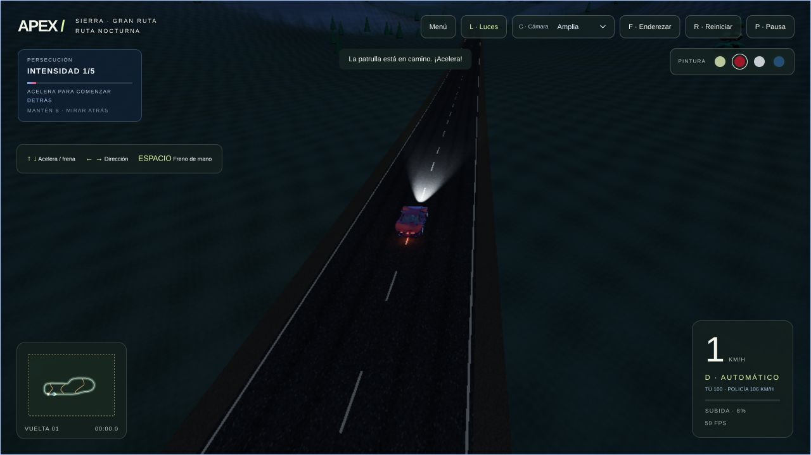
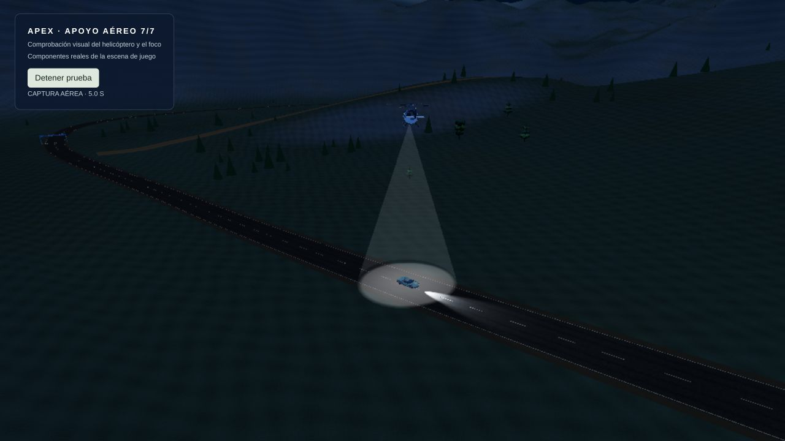

# APEX — Night Drive

### [▶ Jugar ahora](https://apex-night-drive.pages.dev/)

**Una noche, una sierra y una persecución que no deja de crecer.**

Juego de conducción 3D para navegador. Recorre carreteras de montaña, busca atajos de tierra y sal del asfalto para escapar de la policía. Cuanto más tiempo resistas, más peligrosos serán tus perseguidores: primero una patrulla, después refuerzos y finalmente un helicóptero.

Gratis, sin descargas ni instalación. Se juega directamente en [apex-night-drive.pages.dev](https://apex-night-drive.pages.dev/).

## Cómo se juega

El objetivo es **resistir el mayor tiempo posible**. Un choque no termina la partida: una patrulla tiene que mantener **5 segundos de contacto continuo** para capturarte. Separarte reinicia esa cuenta.

El helicóptero utiliza una captura independiente: debes salir de su círculo blanco antes de pasar **5 segundos seguidos bajo el foco**. Salir de la luz reinicia su cuenta.

| Tiempo de persecución      | Intensidad y refuerzos                                              | Velocidades máximas                                        |
| -------------------------- | ------------------------------------------------------------------- | ---------------------------------------------------------- |
| Inicio                     | Nivel 1/5 · Una patrulla                                            | Jugador: 100 km/h · Patrulla: 106 km/h                     |
| Cada 45 s, hasta los 3 min | Aumenta la intensidad; los límites de velocidad crecen gradualmente | Jugador: hasta 130 km/h · Patrulla: se aproxima a 150 km/h |
| 3 min                      | Nivel 5/5 · Alerta máxima y barra roja intermitente                 | Jugador: 130 km/h · Patrulla: 200 km/h                     |
| 4 min                      | Nivel 6/6 · Llega una segunda patrulla                              | Ambas patrullas: 200 km/h                                  |
| 5 min                      | Nivel 7/7 · Se suma el helicóptero H-01                             | Helicóptero: 230 km/h · Foco de 20 m de diámetro           |

Son límites de velocidad: las pendientes, el agarre, los giros y los golpes afectan la velocidad real de los coches. La pausa detiene el tiempo de persecución.

- **Mundo explorable:** unos 5,2 km de carretera, pendientes de hasta el 27 %, tres atajos y un terreno de 3,8 × 2,9 km.
- **Conducción física:** suspensión por rueda, frenadas, derrapes, saltos y vuelcos. Puedes enderezar tu coche sin reiniciar la dificultad; las patrullas también se recuperan.
- **Persecución dinámica:** la policía anticipa tu movimiento, busca rutas y maniobra para salir de los obstáculos. El helicóptero persigue desde el aire con aceleración e inercia.
- **Ambiente nocturno:** montañas, luna, bosque, faros con encendido manual y luces policiales animadas.
- **Cámaras exteriores:** seguimiento, amplia, táctica y retrovisor; pintura configurable, minimapa y controles táctiles.

## Capturas

_Carretera y terreno explorable durante una partida._

_Prueba visual aislada del apoyo aéreo con los componentes reales del juego; la interfaz de esta captura es de verificación._

## Lenguajes y tecnologías

| Tecnología                       | Uso en el proyecto                                                                               |
| -------------------------------- | ------------------------------------------------------------------------------------------------ |
| **TypeScript 5.9**               | Lógica del juego, controles, IA, navegación, captura y coordinación de la simulación.            |
| **JavaScript · ES modules**      | Modelado procedural de vehículos, helicóptero y elementos del escenario.                         |
| **HTML y CSS**                   | Menú, ayuda, controles, paneles de persecución e interfaz adaptable.                             |
| **GLSL**                         | Shaders del terreno y del efecto circular del foco aéreo.                                        |
| **Three.js 0.128**               | Renderizado WebGL, geometrías, materiales, luces, cámaras y animación de hélices.                |
| **Rapier 3D 0.17 · WebAssembly** | Motor de física: cuerpos rígidos, colisiones y controlador de ruedas.                            |
| **GSAP 3.15**                    | Animaciones de entrada de la interfaz.                                                           |
| **Canvas 2D**                    | Texturas generadas por código y dibujo del minimapa.                                             |
| **Vite 8.1**                     | Servidor de desarrollo y empaquetado de la aplicación para producción.                           |
| **Node.js, tsx y Prettier**      | Herramientas de desarrollo: pruebas automatizadas, ejecución de TypeScript y formato del código. |
| **GitHub y Cloudflare Pages**    | Repositorio, historial de cambios y publicación automática del juego.                            |

El juego se ejecuta en el navegador. Node.js se utiliza para desarrollar, comprobar y compilar el proyecto; no es necesario un servidor de juego para ejecutar la partida.

## Cómo se construyó

### Modelos y escenario procedurales

El deportivo se construye por código a partir de geometrías 3D: carrocería, cabina, ruedas, faros y bajos cerrados. Las patrullas reutilizan ese diseño con pintura, rótulos y luces propios. El H-01 tiene un modelo independiente con rotor principal y rotor de cola animados.

El terreno, la carretera, los caminos y el bosque también se generan mediante código. Las texturas procedurales aportan detalle al asfalto y a la vegetación. La escena combina estos elementos con materiales e iluminación nocturna de Three.js.

### Física e inteligencia policial

Rapier simula el mundo a **60 pasos por segundo**. El jugador y las dos patrullas comparten el modelo de conducción: motor, frenos, suspensión, agarre y colisiones. Cada coche tiene su límite de velocidad según la intensidad; todos se procesan en un único paso compartido del mundo físico.

La IA estima hacia dónde se mueve el jugador y busca rutas por la carretera y los atajos. Produce órdenes de dirección, acelerador y freno; el motor físico resuelve el desplazamiento. Si una patrulla se atasca, hace una maniobra breve de recuperación; si vuelca, puede enderezarse automáticamente.

El helicóptero usa un controlador cinemático aéreo independiente, con aceleración, inercia y seguimiento del terreno. Su foco combina un cono translúcido y un círculo adaptado al suelo, sin añadir una luz dinámica ni una pasada de sombras al renderizado.

### Trabajo de optimización

- Carretera simplificada: aproximadamente **80 % menos triángulos** respecto al diseño anterior, conservando el muestreo físico más detallado.
- Terreno y objetos divididos en sectores, descarte fuera de cámara y niveles de detalle según la distancia.
- Geometrías compartidas, objetos estáticos agrupados e instancias para reducir llamadas de dibujo.
- Colisiones de árboles activadas cerca del jugador y de las patrullas, en lugar de simular todo el bosque a la vez.
- Resolución adaptativa, sombras dinámicas desactivadas y efectos de contacto ligeros.
- Minimapa con fondo almacenado e interfaz actualizada con menor frecuencia que la escena 3D.

El rendimiento final depende del dispositivo y del navegador; estas medidas reducen el trabajo gráfico y físico sin eliminar la exploración libre.

### Organización del código

| Carpeta                 | Responsabilidad                                                       |
| ----------------------- | --------------------------------------------------------------------- |
| `src/app`               | Partida, menú, entrada del jugador y coordinación del juego.          |
| `src/vehicle`           | Modelo del coche y física de conducción.                              |
| `src/police`            | Patrullas, navegación, refuerzos, helicóptero y captura aérea.        |
| `src/world`             | Terreno, carretera, vegetación, materiales y visibilidad.             |
| `src/engine`            | Configuración y reglas compartidas, como los límites de velocidad.    |
| `src/ui` y `src/styles` | Minimapa y presentación de la interfaz.                               |
| `tests`                 | Pruebas de conducción, persecución, captura y otras reglas del juego. |

El proyecto utiliza comprobación de tipos con TypeScript, pruebas con el ejecutor nativo de Node.js y verificación de formato con Prettier. Vite genera la versión de producción; Cloudflare Pages la publica automáticamente desde la rama `main` de GitHub.

## Controles

| Acción                                          | Control        |
| ----------------------------------------------- | -------------- |
| Acelerar / frenar y reversa                     | ↑ / ↓ o W / S  |
| Girar                                           | ← / → o A / D  |
| Freno de mano                                   | Espacio        |
| Encender o apagar faros                         | L              |
| Cambiar cámara                                  | C o teclas 1–4 |
| Mirar atrás                                     | Mantener B     |
| Enderezar el coche sin reiniciar la persecución | F              |
| Pausar                                          | P o Esc        |
| Reiniciar la persecución                        | R              |

Las cámaras y la pintura también se eligen desde la barra de controles. La partida se pausa al perder el foco de la ventana.

**[Entra a jugar y comprueba cuánto puedes resistir →](https://apex-night-drive.pages.dev/)**
