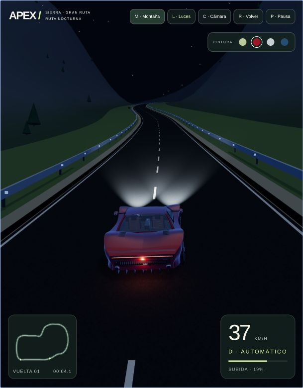

# APEX — Night Drive

Experiencia de conducción nocturna en una ruta de montaña de 5,2 km, con un puerto de montaña de pendientes de hasta el 27%, unos 244 metros de desnivel, dos túneles, luna visible y carro configurable. Aplicación modular con compilación de producción.



## Qué incluye

- Carro procedural con suspensión por rueda, frenado, reversa y colisiones.
- Circuito de 5,2 km con dos túneles, ascensión y descenso de hasta el 27%.
- Ambiente nocturno, luna visible y faros que se pueden encender y apagar.
- Cámaras de seguimiento y conductor, pintura configurable y controles táctiles.
- Minimap, telemetría y acceso directo a la subida con M.

## Ejecutar

Usamos Node.js 24 y npm. Si tienes nvm, ejecuta `nvm use`; la versión está definida en `.nvmrc`.

```sh
git clone https://github.com/miguerg334-afk/videogame.git
cd videogame
# Si usas nvm: nvm use
npm ci
npm run dev
```

Abre http://127.0.0.1:5173. Para comprobar el resultado de producción:

```sh
npm run build
npm run preview
```

La vista previa usa http://127.0.0.1:4173. No se abre el HTML con `file://`: la aplicación necesita un servidor HTTP. `dist/` contiene el resultado listo para un alojamiento estático; hay que subir la carpeta completa, incluidos sus assets.

## Tecnología y decisiones

- **Vite 8** para desarrollo con recarga automática y compilación de producción.
- **TypeScript en modo estricto** para arranque, física del vehículo, ciclo de conducción, cámara, interfaz y gestión de recursos.
- **Three.js** para WebGL y **Rapier 3D** para colisiones, suspensión por rueda y simulación a 120 Hz.
- **GSAP** para las transiciones de color y entrada de interfaz.
- Dependencias npm fijadas y `package-lock.json` para instalaciones reproducibles. La aplicación servida no carga librerías desde CDN.
- Los generadores de geometría del vehículo y la montaña permanecen en módulos JavaScript con interfaces JSDoc. Sus internals no están sometidos a `checkJs`; sus límites se consumen desde TypeScript. Esto conserva el modelo probado sin mezclar esta migración con una reescritura del motor gráfico.
- Conservamos Three.js 0.128 y Rapier 0.17.3 para mantener la iluminación y el comportamiento físico existentes. Una actualización mayor de estos motores requiere su propia revisión visual y física.
- Se usa explícitamente el entry ESM de Rapier 0.17.3, porque el `main` publicado de esa versión apunta a CommonJS dentro de un paquete ESM. La declaración de tipos está en `src/types/rapier.d.ts`.
- No hace falta un servidor de aplicación ni un framework de interfaz para la escena actual. Un reproductor, cuentas o servicios externos pueden añadirse como módulos independientes cuando se definan esos requisitos.

## Estructura

```text
index.html             Documento de entrada y estructura del HUD
src/main.ts            Arranque asíncrono y gestión de errores
src/app/               Sesión de conducción y ciclo de vida de eventos
src/engine/            Renderizador, cámara, matemáticas, tipos y limpieza GPU
src/vehicle/           Modelo procedural y física del vehículo
src/world/             Ruta ampliada, terreno continuo, túneles, colliders y luces
src/ui/                Minimap y acceso tipado al DOM
src/styles/            Estilos de la interfaz
src/types/             Compatibilidad de tipos del motor físico
tests/                 Regresiones de física, ruta y cámara
dist/                  Compilación generada (ignorada en Git)
```

El código fuente se mantiene en `src/`. Las carpetas locales `work/` y `outputs/` contienen prototipos y entregables históricos; están excluidas del repositorio, igual que `node_modules/` y `dist/`. El proyecto se reconstruye con `npm ci` y `npm run build`.

## Comprobaciones

```sh
npm test                # Física real de Rapier en Node, sin navegador
npm run typecheck       # TypeScript
npm run format:check    # Formato
npm run check           # Formato + pruebas + tipos + producción
```

Las pruebas construyen el modelo completo y comprueban que su geometría sea finita; también verifican suspensión, aceleración, frenado, reversa, dirección, colisión con barreras, pendientes de la ruta, apoyo de las ruedas dentro de los túneles, paso por la galería, descenso y cámara dentro del techo. También comprueban que el terreno conserve todos sus triángulos, la búsqueda espacial de la carretera y la tracción en las pendientes del 27%. Solo se simula el lienzo de las texturas: los colliders y la física son reales. La apariencia y los controles se comprueban en navegador con WebGL.

La plantilla `docs/github-actions/check.yml` está preparada para ejecutar `npm ci` y `npm run check` en cada push y pull request, usando Node 24 y permisos de lectura. No despliega ni publica el sitio.

Para activarla, copia ese archivo a `.github/workflows/check.yml` desde GitHub o con credenciales que permitan gestionar workflows. La primera subida deja el flujo como plantilla porque el token usado no tiene el permiso `workflow`.

## Controles

| Acción                               | Control                   |
| ------------------------------------ | ------------------------- |
| Acelerar / frenar y reversa          | ↑ / ↓ o W / S             |
| Dirección                            | ← / → o A / D             |
| Freno de mano                        | Espacio                   |
| Encender/apagar faros                | L                         |
| Cambiar cámara                       | C                         |
| Volver a la carretera                | R                         |
| Ir al comienzo del puerto de montaña | M                         |
| Pausa                                | P o Esc                   |
| Pintura                              | Selector superior derecho |

Los controles táctiles aparecen en dispositivos con puntero táctil. La pintura se conserva localmente. La aplicación se pausa al perder el foco.

## Estado del producto

- Se eliminaron el motor sintetizado, los efectos de choque y su botón de sonido de la aplicación nueva.
- Spotify, reproductor musical y piloto automático aún no están implementados. No se solicitan cuentas ni credenciales.
- El HTML sigue existiendo como entrada estándar de la web; el código ya no vive dentro de un único archivo.
- El paquete de física `compat` incluye WebAssembly en base64 y domina el tamaño de descarga (~904 kB comprimidos). Vite lo separa en un chunk independiente. La advertencia de tamaño de ese chunk y el de Three.js es conocida; no se oculta. Separar el WASM binario o actualizar motores se puede evaluar después con mediciones.
- El cierre de la sesión cancela el bucle de animación y los eventos, libera el mundo físico y los recursos gráficos compartidos.

Documentación de referencia: [Vite](https://vite.dev/guide/), [TypeScript en Vite](https://vite.dev/guide/features.html#typescript), [Rapier](https://rapier.rs/docs/user_guides/javascript/getting_started_js/).

## Trabajar en el repositorio

1. Instala la versión de Node indicada en `.nvmrc` y ejecuta `npm ci`.
2. Crea una rama para el cambio y modifica el código de `src/`.
3. Ejecuta `npm run check`. Si cambias geometría, iluminación, cámara o interfaz, comprueba también el resultado con `npm run preview` después de compilar.
4. Incluye en el commit los cambios de fuente y `package-lock.json` cuando cambien dependencias.

No se necesitan variables de entorno ni credenciales para ejecutar la versión actual. Si se incorporan servicios externos, sus secretos no deben incluirse en el código ni en variables `VITE_*`, que son públicas en el navegador.

El despliegue se configura por separado cuando se decida dónde alojar la aplicación. Este proyecto todavía no declara una licencia de distribución del código propio.
